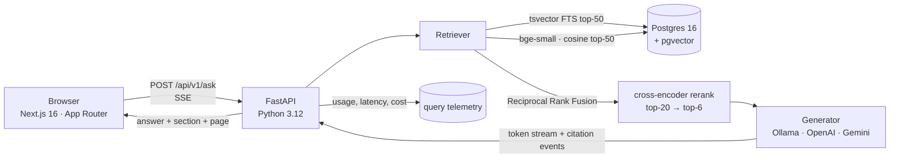

# AskDocs

**Grounded question-answering over Indian tax law — every answer carries a citation you can open and check.**

Most "chat with your PDF" demos produce fluent prose. In tax law a fluent wrong answer costs real money, so AskDocs is built around one constraint: **an answer without a verifiable citation is a failed answer**. The retrieval pipeline is section-aware, the generator is forced to answer only from retrieved statute text, and the evaluation harness scores *citation accuracy* — not how convincing the prose sounds.

> Informational only, not legal advice. Every answer is stamped with the corpus vintage it was drawn from.

**Where the project is right now:** [`docs/STATUS.md`](docs/STATUS.md) — what is verified, what is failing its gate, and the open questions, written for the next session rather than for a demo.

---

## The problem this project refuses to ignore

India's Income-tax Act, 1961 was replaced by the **Income-tax Act, 2025**, in force from **1 April 2026**. A tax assistant that quotes a repealed Act is worse than no assistant at all, and a fixed-window chunker that returns "Section 80C" from the *table of contents* is worse still. Both failure modes are engineered against here:

| Failure mode | How AskDocs handles it |
|---|---|
| Table-of-contents pages retrieved as body text | TOC pages dropped by a short-line-density heuristic before chunking |
| Amended sections silently dropped (`4[80C.` footnote prefix in statute PDFs) | Section regex tolerates the footnote prefix — 1,049 sections survive |
| Answers that sound right but cite nothing | Citation is parsed and validated against retrieved context before the answer is released |
| Confident answers to out-of-corpus questions | Low-confidence retrieval triggers an explicit refusal, and refusal correctness is a scored metric |
| Mixed-vintage law | Every chunk carries `doc_id` + `vintage`; the UI shows which Act and "as on" date the answer came from |
| Two printings of the same statute | Extraction mode and header style are per-document facts in `data/manifest.json` — the gazette PDF needs `-raw` with title-above-number headers, the older consolidated copy needs `-layout` with inline headers |

---

## What is actually built today

| Layer | State |
|---|---|
| **Corpus + ingestion** | ✅ Done — 6 official documents → 11,069 section-tagged chunks, both Acts included |
| **Reproducibility** | ✅ Done — `fetch_corpus.py` (hash-verified, Wayback fallback), `doctor.py`, `AGENTS.md`, persisted design system |
| **Standards** | ✅ Defined — ECC for code review, UI UX Pro Max for UI; gates in `docs/STANDARDS.md` |
| **Retrieval (hybrid + rerank)** | ✅ Week 1 — Postgres + pgvector, IDF-weighted full-text, RRF, cross-encoder; **recall@10 0.89** vs 0.80 dense-only |
| **Grounded generation + streaming API** | ✅ Built (W2) — `/ask` SSE, citation validation, refusal path, three provider adapters. **Accuracy gate missed on this machine**: 3B @ 0.50 citation accuracy, 7B @ 4.6 tok/s. See below. |
| **Chat UI, citation viewer, history** | 🚧 Chat surface shipped (W2): streamed answer, inline `[n]` chips that open the section, refusal state, `Stop`. Evidence panel is inline for now; history lands W3 |
| **Eval harness (40-question golden set)** | 🚧 Week 1 retrieval half ✅ (`docs/eval/retrieval-w1.md`, failures classified); end-to-end scoring lands W3 |
| **Deploy, CI, load test, docs with measured numbers** | 🚧 Week 4 |

Full four-week plan, with exit criteria per week: **[docs/PLAN.md](docs/PLAN.md)**.

### Week 2, measured on this machine — the target is missed, and here is why

The grounded path works end to end: the answer streams, every claim carries a
marker, unknown markers fail validation, and an unanswerable question is refused
with a reason instead of guessed at. What does not work here is the model.

| | qwen2.5:7b-instruct (documented default) | qwen2.5:3b-instruct | qwen2.5:1.5b-instruct (demo) |
|---|---|---|---|
| generation | **4.6 tok/s** | 6.1 tok/s | 9.4 tok/s |
| prompt processing | 35 tok/s | ~55 tok/s | 49 tok/s |
| first token p95 | ~70 s (est.) | 19.0 s | 12.1 s → 30.8 s ᶜ |
| end-to-end p95 | — | 31.9 s | 36.0 s |
| citation accuracy | not run to completion | 0.50 ᵖ | **0.80** ✅ (n=10) |
| fact recall | — | 0.40 ᵖ | 0.30 |
| refusal correctness | — | 0.90 ᵖ | **1.00** |
| over-refusals (in-corpus) | — | 2 ᵖ | **0** |

ᵖ measured before the RRF floor landed (2026-11-23); the 3B re-run aborted after 3 of 6
questions with a connection error and no report was written, so that row is stale rather
than failed. The 1.5B row is the current one and clears the citation gate.

ᶜ the second figure was measured while another project's dev servers were using ~300% CPU
(load average 37). Treat it as an upper bound, not a like-for-like comparison — the floor
does cost real prompt tokens (6 → 9 sources, ~1.7 k → ~2.6 k tokens), so some increase is
expected and the exact number needs a quiet machine.

Two conclusions, both measured rather than argued:

1. **Latency cannot be fixed by model size on this box.** Generation speed improves 2×
   from 7B to 1.5B, but first token only halves — because the cost is *prompt
   processing* of a 2.5 k-token source block, not generation. No qwen2.5 size reaches a
   1.5 s first token here.
2. **Citation accuracy was not a model problem — it was the reranker, and it is now
   fixed.** Weakening the model from 3B to 1.5B moved citation accuracy by zero, which
   pointed at retrieval. The cause: RRF ranked the right section and the cross-encoder
   dropped it before the prompt was assembled (prompt coverage 0.89 → 0.83). Keeping rerank's
   *order* while re-admitting what RRF had already earned took citation accuracy from
   0.70 to **0.80** at n=10 with no ranking metric changed — see the commit and
   [`docs/STATUS.md`](docs/STATUS.md). What is left is **fact recall at 0.30**, which the
   same change did not move at all: the model now gets the right section and still fails
   to quote the clause inside it. That one is generation.

An 8 GB M2 with a 4 GB Docker VM cannot run a 7B model and a Postgres + pgvector
stack at once. Of the two gates, **citation accuracy ≥ 0.80 is met on the demo model**
and **first token ≤ 1.5 s is not met locally and cannot be** — that needs a hosted key or
a GPU, which are config changes, not code; reports: [`docs/eval/latest.md`](docs/eval/latest.md) and
[`docs/eval/failures.md`](docs/eval/failures.md).

### Corpus (measured, not estimated)

| Document | Publisher | Vintage | Applies to | Pages | Sections | Chunks |
|---|---|---|---|---|---|---|
| **Income-tax Act, 2025** | Govt. of India — Act No. 30 of 2025 | as amended by **Finance Act, 2026** | Tax Year 2026-27 onwards | 687 | 513 of 536 + 16 schedules | 1,762 |
| **Income-tax Rules, 2026** | CBDT, Notification 22/2026 | notified 20 Mar 2026 | Tax Year 2026-27 onwards | 977 | 327 of 333 | 2,670 |
| Income-tax Act, 1961 | Govt. of India | consolidated to **FA 2021** | AY 2026-27 and earlier | 956 | 768 | 3,852 |
| CGST Act, 2017 | CBIC | as on 01.08.2021 | GST — ongoing | — | 168 | 579 |
| CGST Rules, 2017 | CBIC | as on 30.12.2017 | GST — ongoing | — | 176 | 889 |
| CBDT taxpayer FAQs | Income Tax Dept | undated | eval only | — | — | 1,317 |
| **Total** | | | | | **1,968 pairs** | **11,069** |

**8.69 M characters**, median chunk 877 chars, hard cap 1,343. Source URLs, retrieval route, HTTP status, byte counts and SHA-256 prefixes for every document are in [`data/sources.json`](data/sources.json); the parsing decisions are in [`data/README.md`](data/README.md). Counts are the output of pdftotext 26.11.0 — the extractor version is recorded in `data/processed/stats.json` and checked by `doctor.py`, because a different poppler build lays the same bytes out differently.

Both Acts are in the corpus on purpose. The 2025 Act governs income from 1 April 2026; the 1961 Act still governs every tax year that began before it — returns, assessments, appeals and TDS corrections continue under it (s. 536 savings). A useful assistant must retrieve from both and say which one applies, which is why `applies_to_ay` is per-document metadata rather than a prompt string.

`incometaxindia.gov.in` returns **403 to this network**, so the two new documents came from Wayback snapshots of the same official URLs — recorded with snapshot timestamps, because a snapshot is not the live page.

---

## Architecture



**Retrieval is hybrid on purpose.** Vector search alone misses statutory phrases ("notwithstanding anything contained in"), and full-text alone misses paraphrase ("how much can I deduct for my kid's tuition"). Both candidate lists are fused with Reciprocal Rank Fusion, then a cross-encoder reranker picks the six passages that actually go into the prompt.

**Generation is provider-agnostic.** One `Generator` protocol, three adapters: local Ollama (default, zero cost, works offline), OpenAI and Gemini. The default is local so the whole system is reproducible and free to demo; hosted adapters exist to show that swapping providers is a config change, not a rewrite.

Full component detail, data model and failure modes: **[docs/ARCHITECTURE.md](docs/ARCHITECTURE.md)**.
API contract and SSE event schema: **[docs/API.md](docs/API.md)**.
Evaluation methodology: **[docs/EVAL.md](docs/EVAL.md)**.

---

## Stack

| Layer | Choice | Why |
|---|---|---|
| Frontend | Next.js 16 (App Router), TypeScript strict, Tailwind 4 | Streaming UI, server components for the corpus browser, no client-side key exposure |
| Backend | FastAPI, Pydantic v2, `sse-starlette` | Python is where the retrieval and eval code lives; SSE keeps the token stream simple |
| Store | Postgres 16 + pgvector, `tsvector` GIN index | One database for vectors, full-text and product data instead of three services |
| Embeddings | `BAAI/bge-small-en-v1.5` (384-d, in-process) | CPU-fast, no per-query cost, deterministic — reruns of the eval are comparable |
| Reranker | `cross-encoder/ms-marco-MiniLM-L-6-v2` | Biggest single accuracy win per millisecond on short statute passages |
| Generation | Ollama `qwen2.5:7b-instruct` (default), OpenAI / Gemini adapters | Free, offline, demoable — and genuinely swappable |
| Ingestion | Python + poppler `pdftotext -layout` | Preserves indentation that statute PDFs use for sub-clauses |
| Delivery | Docker Compose locally · Vercel + Render + Neon in production | Reproducible dev box, free-tier hosting |

---

## Quickstart (corpus pipeline — works today)

Prerequisites: Python 3.11+, Node 20+, `pdftotext` (poppler), Docker Desktop.

```powershell
git clone https://github.com/Shinzo27/askdocs.git
cd askdocs
python -m venv .venv
.\.venv\Scripts\Activate.ps1

python scripts/fetch_corpus.py   # re-acquires the 6 documents, hash-verified
python scripts/ingest.py         # -> data/processed/chunks.jsonl (11,069 chunks)
python scripts/doctor.py         # environment + corpus integrity; must print READY
```

(`bash`/`zsh`: same commands, `source .venv/bin/activate` instead of the PowerShell activate line.)

`fetch_corpus.py` tries the live source first and falls back to a Wayback snapshot of the same URL — `incometaxindia.gov.in` returns 403 to this network, and Wayback truncates large transfers, so the script resumes with HTTP Range requests until the byte count matches the recorded size. Every file is verified against the SHA-256 prefix in `data/manifest.json`, so a re-fetch cannot quietly change the corpus your eval numbers came from. `doctor.py` prints the `corpus_hash` to quote in every eval report.


The only external dependency is poppler's `pdftotext` binary (`winget install oschwartz10612.Poppler` on Windows, `apt install poppler-utils` on Debian). Pipeline dependencies are pinned in `requirements-dev.txt` from Week 1, when the retrieval and eval code lands.


The raw corpus is deliberately **not** committed: 28 MB of government PDFs and a 12 MB chunk file do not belong in git. `data/raw/` and `data/processed/` are gitignored; `data/sources.json` records where every file came from and the SHA-verified byte size.

The application stack (`docker compose up`) arrives in Week 1 — this README will grow a one-command path once there is something to run.

---

## Portable by construction

Switching laptops, or switching agent, should not change the answers. Four things make that true:

| Mechanism | What it prevents |
|---|---|
| [`AGENTS.md`](AGENTS.md) — the entry point any agent reads first: invariants, commands, traps already paid for | an agent re-deriving the parser from scratch and losing 23 sections |
| `scripts/fetch_corpus.py` + hashes in `data/manifest.json` | a re-downloaded corpus that silently differs from the one the numbers came from |
| `scripts/doctor.py` — interpreter, poppler, per-document hashes, pinned chunk counts, `corpus_hash` | "it works on my machine"; a parser tweak that shrinks the corpus |
| [`design-system/askdocs/MASTER.md`](design-system/askdocs/MASTER.md) — persisted design system, page overrides in `pages/` | each new session inventing a different UI |

The corpus is 28 MB of government PDFs, deliberately **not** committed, so the bootstrap is `fetch → ingest → doctor`, and `doctor` is the gate: it fails loudly rather than letting a partial corpus be cited from.

## How quality is decided

Two external skill sets are the review criteria, not decoration. Details and install commands: **[docs/STANDARDS.md](docs/STANDARDS.md)**.

| Toolchain | Decides | Artefact |
|---|---|---|
| [**ECC**](https://github.com/affaan-m/ECC) — agent-harness OS (72 agents, 328 skills) | code review, API design, DB/retrieval patterns, security, testing, delivery | gate table in `docs/STANDARDS.md` |
| [**UI UX Pro Max**](https://github.com/nextlevelbuilder/ui-ux-pro-max-skill) | design system, accessibility, interaction, responsive layout | `design-system/askdocs/` (Master + tokens + page overrides) |

A change passes only when the code gate **and** the design checklist both pass; a README claim must name the artefact that proves it.

---

## Evaluation is the headline feature

RAG demos usually ship without numbers. AskDocs ships a **40-question golden set** written by hand from the corpus, each entry carrying the expected section, 2–4 atomic facts the answer must contain, and the tempting wrong answer it must *not* produce (`must_not_say`). Scored metrics:

| Metric | Definition | Why it is the metric |
|---|---|---|
| **Citation accuracy** | cited section == expected section | A confident citation that is wrong is the worst outcome |
| **Fact recall** | required facts present in the answer | Correct section, useless answer is still a failure |
| **Refusal correctness** | out-of-corpus questions refused, in-corpus questions not refused | Measures both hallucination *and* unhelpfulness |
| **p95 latency** | end-to-end, streaming first token separately | Real UX number, not an average |
| **Cost per query** | tokens × price, plus embedding amortisation | Makes "free tier" claims honest |

Thresholds, question distribution and the CI gate are specified in **[docs/EVAL.md](docs/EVAL.md)**.

---

## Roadmap

| Week | Theme | Ships |
|---|---|---|
| **1** | Ground truth first | Corpus complete (11,069 chunks, both Acts) → pgvector schema, hybrid retrieval + rerank, retrieval eval, **app shell with tokens applied** |
| **2** | Answer generation | Grounded prompting, citation validation, refusal path, SSE API, **chat UI with all five states** |
| **3** | Product surface | Citation viewer with PDF page jump, corpus browser, history, feedback, eval dashboard, committed screenshots |
| **4** | Harden and ship | Deploy, load test, axe 0 violations / Lighthouse ≥ 95, README with measured numbers, 90-second demo |

---

## What this project demonstrates

- Retrieval engineering that handles real statutory text (TOC detection, footnote-prefixed amendments, section-level metadata).
- Hybrid search (dense + lexical + RRF) and cross-encoder reranking, evaluated rather than asserted.
- Streaming LLM UX: token-level SSE, citation events, refusal states, inline source panel.
- Provider abstraction with a local default — no vendor lock, no API key needed to run it.
- Measurement discipline: golden set, per-metric thresholds, CI regression gate, cost and latency telemetry.
- Reproducible engineering: hash-pinned corpus re-fetch with a live→archive fallback, a `doctor` gate on the corpus, an agent-agnostic `AGENTS.md` handoff, and a committed design system so a different machine or agent produces the same result.
- Full-stack delivery: typed API contract, Postgres schema and migrations, Docker, CI, deployment.

## License

Code: MIT (see [LICENSE](LICENSE)). Indian statutes and rules are government works, reproduced with attribution — see [`data/README.md`](data/README.md) for the per-document terms. The CBDT FAQ mirror declares **no license** and is used locally for answer-shape reference only; it is never redistributed or shipped inside the app.
