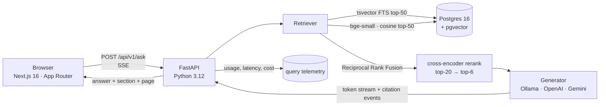

# AskDocs

**Grounded question-answering over Indian tax law — every answer carries a citation you can open and check.**

Most "chat with your PDF" demos produce fluent prose. In tax law a fluent wrong answer costs real money, so AskDocs is built around one constraint: **an answer without a verifiable citation is a failed answer**. The retrieval pipeline is section-aware, the generator is forced to answer only from retrieved statute text, and the evaluation harness scores *citation accuracy* — not how convincing the prose sounds.

> Informational only, not legal advice. Every answer is stamped with the corpus vintage it was drawn from.

---

## The problem this project refuses to ignore

India's Income-tax Act, 1961 was replaced by the **Income-tax Act, 2025**, in force from **1 April 2026**. A tax assistant that quotes a repealed Act is worse than no assistant at all, and a fixed-window chunker that returns "Section 80C" from the *table of contents* is worse still. Both failure modes are engineered against here:

| Failure mode | How AskDocs handles it |
|---|---|
| Table-of-contents pages retrieved as body text | TOC pages dropped by a short-line-density heuristic before chunking |
| Amended sections silently dropped (`4[80C.` footnote prefix in statute PDFs) | Section regex tolerates the footnote prefix — 1,049 sections survive |
| Answers that sound right but cite nothing | Citation is parsed and validated against retrieved context before the answer is released |
| Confident answers to out-of-corpus questions | Low-confidence retrieval triggers an explicit refusal, and refusal correctness is a scored metric |
| Mixed-vintage law | Every chunk carries `doc_id` + `vintage`; the UI shows which Act and "as on" date the answer came from |

---

## What is actually built today

| Layer | State |
|---|---|
| **Corpus + ingestion** | ✅ Done — 4 official documents → 6,626 section-tagged chunks |
| **Retrieval (hybrid + rerank)** | 🚧 Week 1 |
| **Grounded generation + streaming API** | 🚧 Week 2 |
| **Chat UI, citation viewer, history** | 🚧 Week 2–3 |
| **Eval harness (40-question golden set)** | 🚧 Week 1 (retrieval), Week 3 (end-to-end) |
| **Deploy, CI, load test, docs with measured numbers** | 🚧 Week 4 |

Full four-week plan, with exit criteria per week: **[docs/PLAN.md](docs/PLAN.md)**.

### Corpus (measured, not estimated)

| Document | Publisher | Vintage | Pages | Sections | Chunks |
|---|---|---|---|---|---|
| Income-tax Act, 1961 | Govt. of India | consolidated to **FA 2021** | 956 | 705 | 3,868 |
| CGST Act, 2017 | CBIC | as on 01.08.2021 | — | 175 | 578 |
| CGST Rules, 2017 | CBIC | as on 30.12.2017 | — | 169 | 863 |
| CBDT taxpayer FAQs | Income Tax Dept | undated | — | — | 1,317 |
| **Total** | | | | **1,049 unique** | **6,626** |

**4.95 M characters**, median chunk 817 chars, hard cap 1,344. Source URLs, HTTP status and byte counts for every document are recorded in [`data/sources.json`](data/sources.json); the reasoning behind the chunker is in [`data/README.md`](data/README.md).

The 1961 Act is still in the corpus on purpose: it governs every tax year that began before 1 April 2026, so returns, assessments and appeals for AY ≤ 2026-27 must still be answered from it. The Act 2025 and Rules 2026 PDFs land in Week 1 — `python scripts/ingest.py` picks them up with no code change.

---

## Architecture



**Retrieval is hybrid on purpose.** Vector search alone misses statutory phrases ("notwithstanding anything contained in"), and full-text alone misses paraphrase ("how much can I deduct for my kid's tuition"). Both candidate lists are fused with Reciprocal Rank Fusion, then a cross-encoder reranker picks the six passages that actually go into the prompt.

**Generation is provider-agnostic.** One `Generator` protocol, three adapters: local Ollama (default, zero cost, works offline), OpenAI and Gemini. The default is local so the whole system is reproducible and free to demo; hosted adapters exist to show that swapping providers is a config change, not a rewrite.

Full component detail, data model and failure modes: **[docs/ARCHITECTURE.md](docs/ARCHITECTURE.md)**.
API contract and SSE event schema: **[docs/API.md](docs/API.md)**.
Evaluation methodology: **[docs/EVAL.md](docs/EVAL.md)**.

---

## Stack

| Layer | Choice | Why |
|---|---|---|
| Frontend | Next.js 16 (App Router), TypeScript strict, Tailwind 4 | Streaming UI, server components for the corpus browser, no client-side key exposure |
| Backend | FastAPI, Pydantic v2, `sse-starlette` | Python is where the retrieval and eval code lives; SSE keeps the token stream simple |
| Store | Postgres 16 + pgvector, `tsvector` GIN index | One database for vectors, full-text and product data instead of three services |
| Embeddings | `BAAI/bge-small-en-v1.5` (384-d, in-process) | CPU-fast, no per-query cost, deterministic — reruns of the eval are comparable |
| Reranker | `cross-encoder/ms-marco-MiniLM-L-6-v2` | Biggest single accuracy win per millisecond on short statute passages |
| Generation | Ollama `qwen2.5:7b-instruct` (default), OpenAI / Gemini adapters | Free, offline, demoable — and genuinely swappable |
| Ingestion | Python + poppler `pdftotext -layout` | Preserves indentation that statute PDFs use for sub-clauses |
| Delivery | Docker Compose locally · Vercel + Render + Neon in production | Reproducible dev box, free-tier hosting |

---

## Quickstart (corpus pipeline — works today)

Prerequisites: Python 3.11+, Node 20+, `pdftotext` (poppler), Docker Desktop.

```powershell
git clone https://github.com/Shinzo27/askdocs.git
cd askdocs
python -m venv .venv
.\.venv\Scripts\Activate.ps1

# ingestion is stdlib-only: no pip install, no API key, no network
python scripts/ingest.py
# -> data/processed/chunks.jsonl  (6,626 chunks)
# -> data/processed/stats.json
```

The only external dependency is poppler's `pdftotext` binary (`winget install oschwartz10612.Poppler` on Windows, `apt install poppler-utils` on Debian). Pipeline dependencies are pinned in `requirements-dev.txt` from Week 1, when the retrieval and eval code lands.


The raw corpus is deliberately **not** committed: 16 MB of government PDFs and a 10 MB chunk file do not belong in git. `data/raw/` and `data/processed/` are gitignored; `data/sources.json` records where every file came from and the SHA-verified byte size.

The application stack (`docker compose up`) arrives in Week 1 — this README will grow a one-command path once there is something to run.

---

## Evaluation is the headline feature

RAG demos usually ship without numbers. AskDocs ships a **40-question golden set** written by hand from the corpus, each entry carrying the expected section, 2–4 atomic facts the answer must contain, and the tempting wrong answer it must *not* produce (`must_not_say`). Scored metrics:

| Metric | Definition | Why it is the metric |
|---|---|---|
| **Citation accuracy** | cited section == expected section | A confident citation that is wrong is the worst outcome |
| **Fact recall** | required facts present in the answer | Correct section, useless answer is still a failure |
| **Refusal correctness** | out-of-corpus questions refused, in-corpus questions not refused | Measures both hallucination *and* unhelpfulness |
| **p95 latency** | end-to-end, streaming first token separately | Real UX number, not an average |
| **Cost per query** | tokens × price, plus embedding amortisation | Makes "free tier" claims honest |

Thresholds, question distribution and the CI gate are specified in **[docs/EVAL.md](docs/EVAL.md)**.

---

## Roadmap

| Week | Theme | Ships |
|---|---|---|
| **1** | Ground truth first | Act 2025 + Rules 2026 ingested, pgvector schema, hybrid retrieval + rerank, retrieval eval |
| **2** | Answer generation | Grounded prompting, citation validation, refusal path, SSE API, chat shell |
| **3** | Product surface | Citation viewer with PDF page jump, conversation history, feedback loop, eval dashboard |
| **4** | Harden and ship | CI/CD, deploy, load test, a11y pass, README with measured numbers, demo recording |

---

## What this project demonstrates

- Retrieval engineering that handles real statutory text (TOC detection, footnote-prefixed amendments, section-level metadata).
- Hybrid search (dense + lexical + RRF) and cross-encoder reranking, evaluated rather than asserted.
- Streaming LLM UX: token-level SSE, citation events, refusal states, inline source panel.
- Provider abstraction with a local default — no vendor lock, no API key needed to run it.
- Measurement discipline: golden set, per-metric thresholds, CI regression gate, cost and latency telemetry.
- Full-stack delivery: typed API contract, Postgres schema and migrations, Docker, CI, deployment.

## License

Code: MIT (see [LICENSE](LICENSE)). Indian statutes and rules are government works, reproduced with attribution — see [`data/README.md`](data/README.md) for the per-document terms. The CBDT FAQ mirror declares **no license** and is used locally for answer-shape reference only; it is never redistributed or shipped inside the app.
